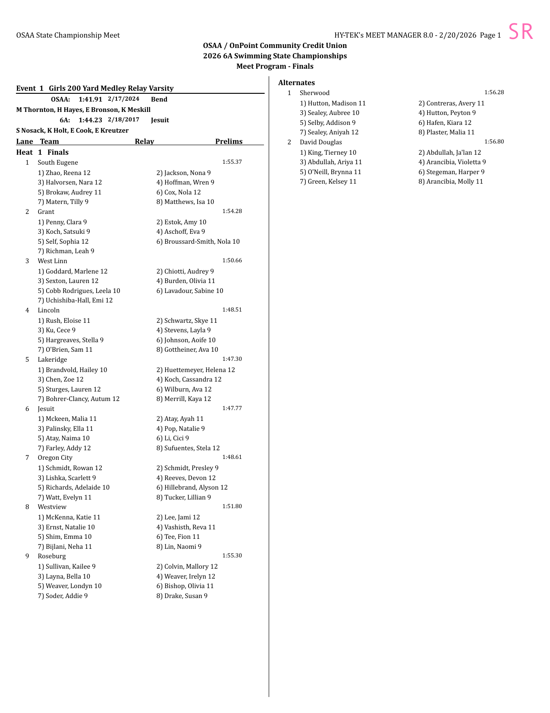
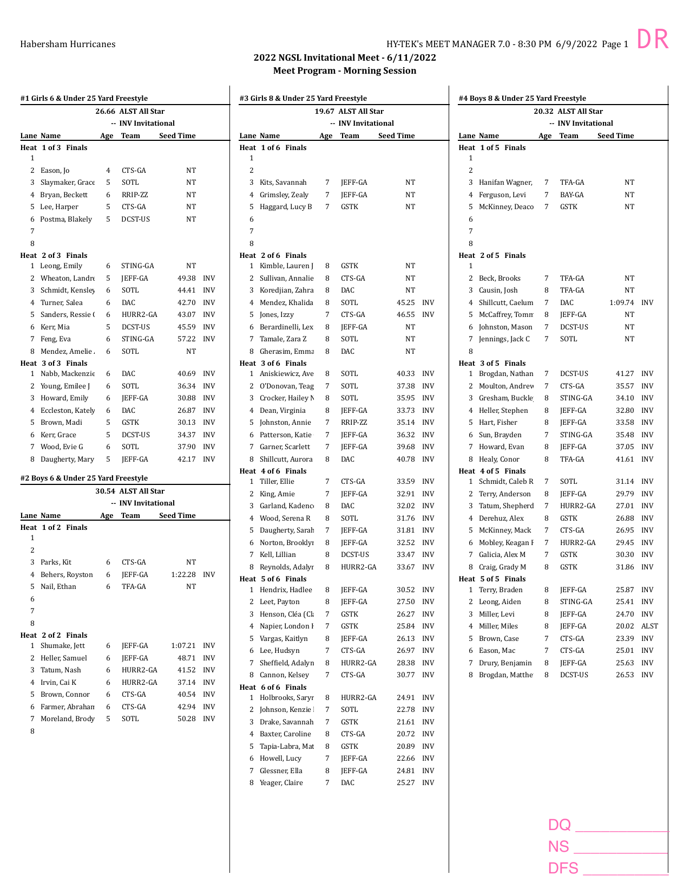

# heatSheetStamper

Adds a DQ / NS / DFS scoring stamp to the bottom-right corner of every page in a swim meet heat sheet PDF.

## Requirements

- Python 3.9+
- [uv](https://docs.astral.sh/uv/)
- [pypdf](https://pypdf.readthedocs.io/) `>=6,<7`
- [reportlab](https://www.reportlab.com/opensource/) `>=4`

Install dependencies:

```bash
uv sync
```

## Usage

```
uv run stamp_pdf.py [--sr | --dr | --auto] input.pdf [output.pdf]
```

If `output.pdf` is omitted the stamped file is saved as `input_stamped.pdf` in the same directory.

Note: `uv run` activates the project's managed venv automatically — no need to source anything by hand.

### Flags

| Flag | Effect |
|---|---|
| *(none)* | Bottom-right DQ/NS/DFS stamp only |
| `--sr` | "SR" in the top-right corner only (no bottom-right stamp) |
| `--dr` | "DR" in the top-right corner + bottom-right DQ/NS/DFS stamp |
| `--auto` | Produces both output files in one pass (see below) |
| `--help` | Print usage and exit |

### --auto mode

Produces two output files derived from the input filename:

```
uv run stamp_pdf.py --auto ../examples/ngsl-invitational-2022.pdf
# → ../examples/ngsl-invitational-2022-sr.pdf
# → ../examples/ngsl-invitational-2022-dr.pdf
```

### Single-flag examples

```
uv run stamp_pdf.py ../examples/ngsl-invitational-2022.pdf
# → ../examples/ngsl-invitational-2022_stamped.pdf

uv run stamp_pdf.py --sr ../examples/ngsl-invitational-2022.pdf
# → ../examples/ngsl-invitational-2022_stamped.pdf  (SR corner only)

uv run stamp_pdf.py --dr ../examples/ngsl-invitational-2022.pdf out.pdf
# → out.pdf  (DR corner + DQ/NS/DFS stamp)
```

## Stamp appearance

| `--sr` | `--dr` |
|:---:|:---:|
|  |  |

**Bottom-right stamp** — three lines in hot pink (Helvetica-Bold), right-aligned:

```
DQ ___________
NS ___________
DFS __________
```

The block is 1.5 inches wide with an 18 pt margin from the page edges. Font size is scaled automatically so the widest line fills exactly 1.5 inches regardless of the page size.

**Top-right corner label** (SR or DR) — 25 pt Andale Mono in hot pink, right-aligned at the top-right corner.

## Safety limits

The tool enforces the following limits to guard against malicious or malformed input:

| Limit | Default | Constant |
|---|---|---|
| Maximum input file size | 100 MB | `MAX_INPUT_BYTES` |
| Maximum page count | 5,000 pages | `MAX_PAGES` |

Input must be a `.pdf` file and a regular file (device files and named pipes are rejected). Page dimensions are validated for finite, positive values. Output is written atomically via a temp file so no partial output is left on failure.

## Development

Dev dependencies (pytest, pylint, pymupdf) are installed automatically by `uv sync`.

Run tests:

```bash
uv run pytest test_stamp_pdf.py -v
```

Run linter (currently scores 10.00/10):

```bash
uv run pylint stamp_pdf.py
```

68 tests cover unit behavior, integration across page sizes, CLI argument handling (including `--auto`), and security cases including: corrupt/empty/encrypted PDFs, symlink attacks, path traversal, non-regular file input, decompression bomb limits, page count limits, atomic write safety, and terminal escape injection.

`TestRealExamples` additionally runs the tool end-to-end against every file in [../examples/](../examples/) as a regression check against real Meet Manager output (not just synthetic PDFs).

## Example files

Real, publicly-published Meet Manager heat sheets live in [../examples/](../examples/) at the repo root — shared with [meet-report-formatter](../meet-report-formatter/), since both tools need real Meet Manager layouts to test against. See that folder's own notes for the file list and sources.

`examples/images/` in this directory holds the generated README screenshots (checked in separately since they're specific to this tool's docs).
